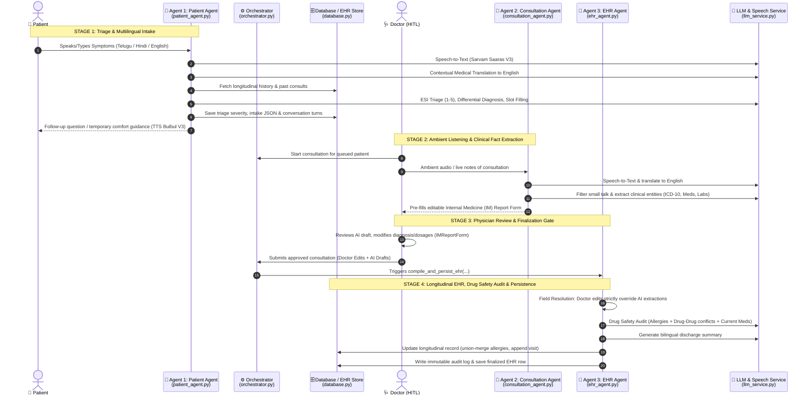

# MediAgent: Agent Research & Code Architecture Walkthrough

This document is prepared specifically for an **Agents Research Role Interview**. It provides a rigorous, code-mapped explanation of the agentic AI architecture in MediAgent, detailing how each agent operates, how they interact with each other, how clinical state flows across boundaries, and the specific files and line numbers to present during a live code walkthrough.

---

## 1. Executive Summary & Agent Research Framework

### Research Paradigm
MediAgent is designed as a **Hierarchical Orchestrator Multi-Agent System (MAS)** with strict **Deterministic Human-in-the-Loop (HITL) Guardrails**. 

In clinical AI research, fully autonomous agent loops (like unconstrained ReAct or AutoGPT) pose catastrophic risk: hallucinated drug dosages or unverified diagnoses can cause patient harm. MediAgent solves this via:
1. **Specialized Task Decompositions**: Three distinct agents with isolated contexts and non-overlapping responsibilities.
2. **Deterministic Data Contracts**: Agents communicate through typed schemas and sanitized JSON payloads rather than unbounded natural language chatter.
3. **Clinical Grounding & Slot-Filling**: State-machine-guided multi-turn clinical history collection.
4. **Physician Veto Authority**: The human doctor acts as an absolute gating function between probabilistic clinical drafts and permanent medical records.

---

## 2. Multi-Agent System (MAS) Interaction Diagram



---

## 3. The Three Agents: In-Depth Roles & Code Implementations

### Agent 1: Patient Intake & Triage Agent
* **Primary Code File**: [`backend/app/services/patient_agent.py`](file:///home/phanindra/Desktop/Projects/mediagent/backend/app/services/patient_agent.py)
* **Prompt & LLM Logic**: [`backend/app/services/llm_service.py#L293-L358`](file:///home/phanindra/Desktop/Projects/mediagent/backend/app/services/llm_service.py#L293-L358)
* **Purpose**: Conducts conversational anamnesis, detects clinical red flags, assigns ESI (Emergency Severity Index) triage scores, and prepares an intake package for the doctor.

#### Key Mechanisms to Highlight in Code:
1. **Longitudinal Context Injection** ([`patient_agent.py:L35-L55`](file:///home/phanindra/Desktop/Projects/mediagent/backend/app/services/patient_agent.py#L35-L55)):
   Before running inference, the agent queries the patient's existing history, known allergies, and past consultation summaries:
   ```python
   history = patient.get("medical_history", "")
   allergies = patient.get("allergies", [])
   past_consults = db.get_consultations(patient_id)
   # Past consults and prescribed medications are concatenated into the prompt context
   ```
2. **Cross-Lingual Acoustic Grounding** ([`patient_agent.py:L56-L82`](file:///home/phanindra/Desktop/Projects/mediagent/backend/app/services/patient_agent.py#L56-L82)):
   - Maps regional languages (Telugu, Hindi, English) to BCP-47 codes.
   - Routes regional speech to Sarvam Saaras V3 STT.
   - Executes medical-context translation to canonical English (`sarvam_translate`) using LLM prompts that preserve dosage metrics and clinical nuance rather than literal translation.
3. **Deterministic Slot Filling with Adaptive Termination** ([`llm_service.py:L307-L322`](file:///home/phanindra/Desktop/Projects/mediagent/backend/app/services/llm_service.py#L307-L322)):
   - System prompt tracks 6 mandatory clinical slots:
     1. Primary issue / chief complaint
     2. Associated symptoms
     3. Duration
     4. Previous medication / home remedies
     5. Known allergies
     6. Chronic diseases
   - **Research Insight**: The agent enforces single-question turns (`Ask ONE question at a time`) to avoid cognitive overload for distressed patients, and only sets `is_intake_complete: true` once all 6 slots are grounded.
4. **ESI Emergency Severity Scoring** ([`llm_service.py:L326-L333`](file:///home/phanindra/Desktop/Projects/mediagent/backend/app/services/llm_service.py#L326-L333)):
   Assigns a triage score from 1 (Resuscitation/Immediate) down to 5 (Non-urgent), which the frontend doctor dashboard uses to prioritize patient queues.

---

### Agent 2: Ambient Consultation Agent
* **Primary Code File**: [`backend/app/services/consultation_agent.py`](file:///home/phanindra/Desktop/Projects/mediagent/backend/app/services/consultation_agent.py)
* **Prompt & LLM Logic**: [`backend/app/services/llm_service.py#L380-L430`](file:///home/phanindra/Desktop/Projects/mediagent/backend/app/services/llm_service.py#L380-L430)
* **Purpose**: "Listens" to the clinical encounter (doctor-patient dialogue), discards non-clinical conversation/noise, and performs structured information extraction.

#### Key Mechanisms to Highlight in Code:
1. **Acoustic-to-Text Normalization** ([`consultation_agent.py:L17-L31`](file:///home/phanindra/Desktop/Projects/mediagent/backend/app/services/consultation_agent.py#L17-L31)):
   Processes raw doctor-patient audio using Sarvam STT and normalizes multilingual banter into clean English clinical text.
2. **Noise Discrimination & Clinical Entity Extraction** ([`llm_service.py:L380-L417`](file:///home/phanindra/Desktop/Projects/mediagent/backend/app/services/llm_service.py#L380-L417)):
   The LLM prompt instructs:
   > *"Filter out all casual conversation, small talk, greetings, and jokes, and extract ONLY the medically relevant facts."*
   Extracts:
   - Symptoms discussed
   - Provisional Diagnosis
   - ICD-10 clinical coding
   - Structured Prescription list: `name`, `dosage`, `frequency`, `duration`
   - Tests & Investigations categorized by `ordered` (future labs/radiology) vs `performed` (bedside vitals/physical exam)
   - Follow-up conditional rules (e.g., return if fever > 103°F)
3. **Structured Draft Synthesis** ([`consultation_agent.py:L36-L51`](file:///home/phanindra/Desktop/Projects/mediagent/backend/app/services/consultation_agent.py#L36-L51)):
   Returns a clean dictionary payload used to populate the doctor's review form.

---

### Agent 3: EHR & Safety Auditor Agent
* **Primary Code File**: [`backend/app/services/ehr_agent.py`](file:///home/phanindra/Desktop/Projects/mediagent/backend/app/services/ehr_agent.py)
* **Safety Audit LLM Logic**: [`backend/app/services/llm_service.py#L431-L482`](file:///home/phanindra/Desktop/Projects/mediagent/backend/app/services/llm_service.py#L431-L482)
* **Purpose**: Compiles longitudinal health records, enforces doctor overrides, executes safety audits, translates discharge instructions, and generates FHIR/SOAP structures.

#### Key Mechanisms to Highlight in Code:
1. **Strict Hierarchy of Truth (Doctor > AI Draft > Patient Intake)** ([`ehr_agent.py:L47-L51`, `L82-L144`](file:///home/phanindra/Desktop/Projects/mediagent/backend/app/services/ehr_agent.py#L47-L51)):
   ```python
   # Diagnosis — Doctor's IM Report edit ALWAYS overrides AI extraction:
   final_diagnosis = (
       doc.get("diagnosis") or
       consultation_output.get("diagnosis") or
       "Undiagnosed"
   ).strip()

   # Medications — Doctor's edit overrides AI extraction:
   final_meds = (
       doc.get("prescribed_drugs") or
       consultation_output.get("prescribed_drugs") or
       consultation_output.get("medications") or []
   )
   ```
2. **Deterministic Guardrails & Regex Sanitization** ([`ehr_agent.py:L12-L30`, `L93-L98`](file:///home/phanindra/Desktop/Projects/mediagent/backend/app/services/ehr_agent.py#L12-L30)):
   AI-generated ICD-10 codes are validated against a formal regex:
   ```python
   ICD10_RE = re.compile(r"^[A-Z][0-9]{2}(\.[0-9]{1,4})?$")
   ```
   If the LLM outputs an invalid code format, the agent demotes it to `"PENDING_VALIDATION"` and sets a flag on the insurance pre-authorization object.
3. **Longitudinal Memory Updates (Never Destructive)** ([`ehr_agent.py:L146-L265`](file:///home/phanindra/Desktop/Projects/mediagent/backend/app/services/ehr_agent.py#L146-L265)):
   - **Allergies**: Union-merge across all visits (`L174-L195`). Past allergies are never wiped out by subsequent intakes.
   - **Active Conditions**: Track `first_seen`, `last_seen`, and visit notes (`L151-L173`).
   - **Medication History**: Previous active medications are archived into `medication_history`, while the new prescription becomes `current_medications` (`L246-L265`).
4. **Automated Clinical Pharmacist Safety Audit** ([`ehr_agent.py:L267-L297`](file:///home/phanindra/Desktop/Projects/mediagent/backend/app/services/ehr_agent.py#L267-L297) & [`llm_service.py:L444-L470`](file:///home/phanindra/Desktop/Projects/mediagent/backend/app/services/llm_service.py#L444-L470)):
   Before persisting, the agent runs a dedicated LLM safety evaluation with strict instructions:
   - Drug-allergy conflicts (e.g., Penicillin allergy vs Amoxicillin prescription).
   - Drug-drug interactions between newly prescribed medications (e.g., Sildenafil + Nitroglycerin).
   - Interactions between new prescriptions and pre-existing medications currently taken by the patient.
   Returns: `has_conflict: bool`, `severity: "None"|"Low"|"Medium"|"High"`, and `description`.
5. **Bilingual Discharge Instruction Generation** ([`ehr_agent.py:L299-L319`](file:///home/phanindra/Desktop/Projects/mediagent/backend/app/services/ehr_agent.py#L299-L319)):
   Converts complex medical instructions into empathetic, plain-language directions translated into the patient's native tongue.

---

## 4. The Orchestrator: Multi-Agent State Management

* **Primary Code File**: [`backend/app/services/orchestrator.py`](file:///home/phanindra/Desktop/Projects/mediagent/backend/app/services/orchestrator.py)

The orchestrator serves as the **State Coordinator** across the patient-doctor timeline.

| Orchestrator Function | Lines | Agent Invoked | State & DB Transformation |
| :--- | :--- | :--- | :--- |
| `orchestrate_patient_intake` | [L6–L51](file:///home/phanindra/Desktop/Projects/mediagent/backend/app/services/orchestrator.py#L6-L51) | **Agent 1** (`patient_agent`) | Creates patient row, runs ESI intake, appends `intake_chat_message` to timeline, sets status to `waiting`. |
| `orchestrate_start_consultation` | [L52–L87](file:///home/phanindra/Desktop/Projects/mediagent/backend/app/services/orchestrator.py#L52-L87) | None (Workflow Transition) | Resolves consultation UUID to profile ID, updates status to `in_consultation`, logs timeline event. |
| `orchestrate_dialogue_processing` | [L88–L117](file:///home/phanindra/Desktop/Projects/mediagent/backend/app/services/orchestrator.py#L88-L117) | **Agent 2** (`consultation_agent`) | Transcribes audio/notes, extracts clinical entities, builds draft IM report. |
| `orchestrate_finalize_consultation` | [L118–L148](file:///home/phanindra/Desktop/Projects/mediagent/backend/app/services/orchestrator.py#L118-L148) | **Agent 3** (`ehr_agent`) | Pulls existing longitudinal record, merges doctor edits, runs safety audit, updates DB & timeline. |

---

## 5. API Layer & Frontend HITL Integration

### Backend API Exposure
* **Primary Code File**: [`backend/app/main.py`](file:///home/phanindra/Desktop/Projects/mediagent/backend/app/main.py)
  - `POST /api/intake` & `/api/intake-audio` ([L64–L117](file:///home/phanindra/Desktop/Projects/mediagent/backend/app/main.py#L64-L117)): Calls `orchestrator.orchestrate_patient_intake`.
  - `POST /api/consult/start` ([L119–L135](file:///home/phanindra/Desktop/Projects/mediagent/backend/app/main.py#L119-L135)): Calls `orchestrator.orchestrate_start_consultation`.
  - `POST /api/consult/transcribe-extract` ([L137–L153](file:///home/phanindra/Desktop/Projects/mediagent/backend/app/main.py#L137-L153)): Calls `orchestrator.orchestrate_dialogue_processing`.
  - `POST /api/consult/finalize` ([L174–L200](file:///home/phanindra/Desktop/Projects/mediagent/backend/app/main.py#L174-L200)): Calls `orchestrator.orchestrate_finalize_consultation`.

### Frontend Doctor-in-the-Loop Workspace
* **Doctor Workspace Route**: [`src/routes/doctor.consultations.$id.tsx`](file:///home/phanindra/Desktop/Projects/mediagent/src/routes/doctor.consultations.$id.tsx)
* **Editable Report Form**: [`src/components/mediagent/im-report-form.tsx`](file:///home/phanindra/Desktop/Projects/mediagent/src/components/mediagent/im-report-form.tsx)
* **Frontend API Bridge**: [`src/lib/api/client.ts`](file:///home/phanindra/Desktop/Projects/mediagent/src/lib/api/client.ts)

**Key Interaction**:
When Agent 2 completes extraction, the frontend populates the `IMReportForm`. The doctor can type in corrections, alter drug dosages, change the provisional diagnosis, or add diagnostic notes. When the doctor clicks **"Approve & Finalize EHR"**, the payload with both `consultation_output` and `doctor_edits` is sent to `/api/consult/finalize`.

---

## 6. Key Agent Research Concepts Implemented in MediAgent

During an agent research interview, frame these implementations in academic / engineering terminology:

### 1. Robust Structured Output Generation (`parse_json_robust`)
* **Code**: [`backend/app/services/llm_service.py:L260-L292`](file:///home/phanindra/Desktop/Projects/mediagent/backend/app/services/llm_service.py#L260-L292)
* **Concept**: Large language models occasionally emit leading conversational text, trailing commas, or unescaped quotes that break native `json.loads`.
* **Solution**: `parse_json_robust` strips markdown blocks (```` ```json ````), extracts substrings between outermost braces `{ ... }`, removes trailing commas via regex, cleans ASCII control characters, and performs quote recovery.

### 2. Guardrails: Combining Probabilistic Reasoning with Deterministic Filters
* **Concept**: Never trust an LLM for safety-critical classification where deterministic rules exist.
* **Implementation**:
  - Regex validation for ICD-10 codes (`_validate_icd10`).
  - Mandatory validation fallback: if LLM fails, code is set to `PENDING_VALIDATION` instead of crashing or hallucinating.
  - Non-blocking audit: drug safety checks run asynchronously and log warnings without halting emergency treatment workflows (`ehr_agent.py:L267-L297`).

### 3. Context Management & State Compaction
* **Concept**: Longitudinal health records can easily exceed context windows or lead to "lost in the middle" attention degradation.
* **Implementation**:
  - The longitudinal record retains compact summaries: `active_conditions`, union of `allergy_records`, archived `medication_history`, and only the **last 10 recent developments** (`ehr_agent.py:L244`).
  - Agent 1 only receives structured previous diagnoses and active allergies rather than multi-page raw transcripts (`patient_agent.py:L41-L55`).

### 4. Hallucination Mitigation in Ambient Extraction
* **Concept**: Ambient conversations contain casual remarks (e.g., "I had a beer yesterday", "My cousin had COVID").
* **Implementation**:
  - Explicit system prompt instructions to discard conversational noise and differentiate between **tests ordered** vs **examinations performed** (`llm_service.py:L392-L396`).
  - Explicit null handling (`follow_up: null` if not discussed) prevents the LLM from inventing return intervals.

---

## 7. Step-by-Step Code Demonstration Guide for the Interview

When asked to demonstrate the project in code, follow this sequence:

| Step | File to Open | Lines to Show | What to Say |
| :---: | :--- | :--- | :--- |
| **1** | [`backend/app/services/orchestrator.py`](file:///home/phanindra/Desktop/Projects/mediagent/backend/app/services/orchestrator.py) | L18–L50, L118–L148 | *"Here is the multi-agent coordinator. MediAgent splits the clinical pipeline into four decoupled stages: intake, session start, ambient extraction, and EHR finalization."* |
| **2** | [`backend/app/services/patient_agent.py`](file:///home/phanindra/Desktop/Projects/mediagent/backend/app/services/patient_agent.py) | L35–L55, L56–L97 | *"This is Agent 1. Notice how we inject the patient's longitudinal history and past consultations before reasoning. It handles multilingual inputs via Sarvam STT and contextual medical translation."* |
| **3** | [`backend/app/services/llm_service.py`](file:///home/phanindra/Desktop/Projects/mediagent/backend/app/services/llm_service.py) | L293–L358 | *"This is the clinical reasoning prompt for Agent 1. It implements adaptive slot-filling (6 clinical facts) and computes an Emergency Severity Index (ESI 1-5) triage score to sort the doctor's queue."* |
| **4** | [`backend/app/services/consultation_agent.py`](file:///home/phanindra/Desktop/Projects/mediagent/backend/app/services/consultation_agent.py) | L12–L51 | *"Agent 2 operates during the live encounter. It transcribes audio and extracts structured clinical entities (provisional diagnosis, ICD-10, medications, labs ordered vs performed)."* |
| **5** | [`src/components/mediagent/im-report-form.tsx`](file:///home/phanindra/Desktop/Projects/mediagent/src/components/mediagent/im-report-form.tsx) | L16–L98 | *"This is our Human-in-the-Loop interface. The AI's draft is pre-populated here, but the physician retains full editing authority over medications, diagnoses, and notes."* |
| **6** | [`backend/app/services/ehr_agent.py`](file:///home/phanindra/Desktop/Projects/mediagent/backend/app/services/ehr_agent.py) | L82–L110, L267–L297 | *"Agent 3 compiles the permanent EHR. Notice the strict hierarchy of truth where doctor edits override AI drafts, the regex validation of ICD-10 codes, and the automated Drug Safety Audit checking drug-drug and drug-allergy interactions."* |

---

## 8. Expected Interview Q&A (Agents Research Focus)

### Q1: Why use three separate agents instead of a single end-to-end prompt?
> **Answer**: 
> 1. **Context Isolation & Noise Reduction**: A single prompt trying to do intake, transcription, clinical extraction, and drug safety checking suffers from severe prompt bloat and attention degradation.
> 2. **State & Time Decoupling**: Intake happens asynchronously at home (hours before the visit); ambient listening happens in the clinic; finalization happens post-visit after physician review.
> 3. **Safety & Auditing**: Dividing into separate agents allows deterministic validation gates between stages (e.g., regex checking and human review before the EHR Agent can write to the database).

### Q2: How do you handle non-deterministic LLM JSON outputs?
> **Answer**: 
> We implement multiple layers of defense:
> 1. In the system prompt, we specify the exact JSON schema and instruct the model not to wrap output in explanations.
> 2. In `llm_service.py`, our `parse_json_robust` utility strips markdown blocks, locates outer `{}` braces, removes invalid trailing commas, and handles quote escaping.
> 3. In `ehr_agent.py`, domain fields like ICD-10 are validated using deterministic regular expressions (`_validate_icd10`).

### Q3: What is your approach to multi-agent memory and state persistence?
> **Answer**:
> We implement a **Hybrid State Architecture**:
> - **Short-term Working Memory**: Ephemeral consultation draft passed between Agent 1, Agent 2, and the frontend review form.
> - **Longitudinal Episodic Memory**: Accumulated in PostgreSQL (`ehr_records` and `profiles`). When Agent 3 finalizes a visit, it performs a union-merge on allergies (so past allergies are never forgotten) and archives active medications into a historical timeline.

### Q4: How do you measure the accuracy or performance of these agents?
> **Answer**:
> In clinical agent research, we evaluate on three distinct axes:
> 1. **Extraction Fidelity**: Named Entity Recognition (NER) F1-score against gold-standard annotated clinical transcripts (for medications, dosages, and ICD-10 codes).
> 2. **Triage Safety**: Sensitivity / Recall on ESI Level 1 and 2 emergency cases (under-triage is fatal; false negatives must approach zero).
> 3. **Intervention Rate (HITL Metric)**: Tracking the edit distance between Agent 2's draft and the doctor's final submitted report. A lower edit distance indicates higher clinical alignment.
