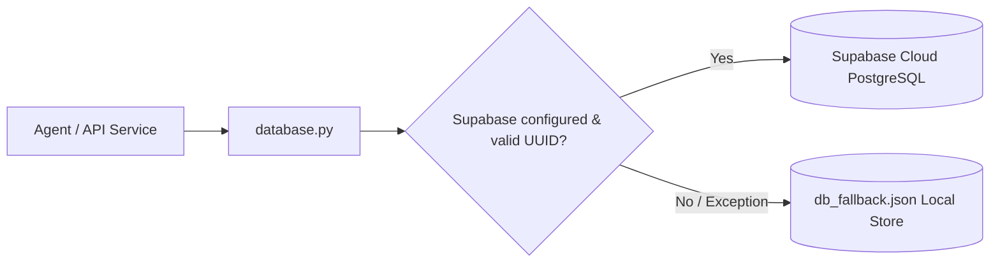
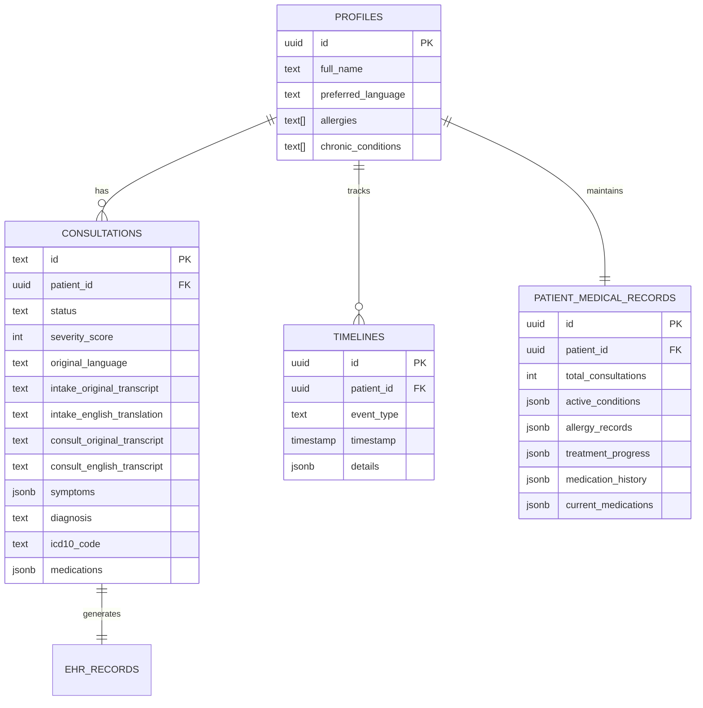

# MediAgent: Research & Engineering Deep-Dive for AI Agent Roles

> **Interview Guide & Technical Monograph**  
> **Role Targeted**: AI Research Scientist / AI Systems Engineer (Autonomous Agents, Multi-Agent Systems, Clinical LLMs)  
> **Project**: [MediAgent](https://github.com/anonymousghost9999/mediagent) — Doctor-in-the-Loop Multi-Agent Hospital Operations & Longitudinal EHR Management  
> **Authors & Equal Contributors**: [@phanindragollapalli](https://github.com/phanindragollapalli), [@anonymousghost9999](https://github.com/anonymousghost9999), [@rider9600](https://github.com/rider9600), [@YVKartikeya9](https://github.com/YVKartikeya9)

---

## Table of Contents
1. [Executive Overview & Elevator Pitch](#1-executive-overview--elevator-pitch)
2. [High-Level Architecture & System Decomposition](#2-high-level-architecture--system-decomposition)
3. [Core Research Problem: Autonomous Agents vs. Clinical Safety](#3-core-research-problem-autonomous-agents-vs-clinical-safety)
4. [Deep Dive: Architectural & Design Choices (The "Why")](#4-deep-dive-architectural--design-choices-the-why)
   - 4.1 Why a 3-Agent Topology Instead of a Monolithic 1-Agent or 10-Agent Swarm?
   - 4.2 Doctor-in-the-Loop as a Formal Epistemic Gate (The 3-Tier Data Precedence Model)
   - 4.3 Deterministic Orchestration vs. Autonomous Emergent Planning (Graph vs ReAct)
   - 4.4 Canonical Normalization & Multi-Tier Medical Translation Engine
   - 4.5 Non-Blocking Resilient Safety Auditing & Asynchronous Failure Boundaries
   - 4.6 Dual-Mode Persistence: Enterprise Supabase vs. Resilient Offline Local JSON Fallback
5. [Agent-by-Agent Implementation & Code-Level Walkthrough](#5-agent-by-agent-implementation--code-level-walkthrough)
   - 5.1 Orchestrator Engine (`backend/app/services/orchestrator.py`)
   - 5.2 Patient Agent (`backend/app/services/patient_agent.py`)
   - 5.3 Consultation Agent (`backend/app/services/consultation_agent.py`)
   - 5.4 EHR Agent & Longitudinal Synthesis (`backend/app/services/ehr_agent.py`)
   - 5.5 LLM, Multimodal & Speech Engine (`backend/app/services/llm_service.py`)
6. [Data Schema, Auditability, and Longitudinal Memory](#6-data-schema-auditability-and-longitudinal-memory)
7. [Comprehensive Interview Q&A (Defense, Edge Cases & Research Trade-offs)](#7-comprehensive-interview-qa-defense-edge-cases--research-trade-offs)
8. [Future Horizons & Research Extensions](#8-future-horizons--research-extensions)

---

## 1. Executive Overview & Elevator Pitch

### The 30-Second Elevator Pitch
> *"MediAgent is a specialized multi-agent clinical workflow platform that automates patient triage, ambient consultation transcription, and longitudinal EHR compilation while guaranteeing clinical safety via a strict Doctor-in-the-Loop epistemic gate. Rather than deploying an unconstrained monolithic LLM, we designed a pipeline of three role-separated agents—Patient Intake, Ambient Consultation, and EHR Persistence—coordinated by a deterministic orchestrator. The system solves the real-world friction of clinical hallucination, multi-dialect translation drift, and medical record corruption through a 3-tier data precedence hierarchy, clinical safety audits, and an append-only longitudinal event store."*

### Key Metrics & Highlights
- **Architecture**: 3-Agent Pipeline with State Machine Orchestration.
- **Foundation Models**: Google Gemini 2.5 Flash (via OpenRouter) for multimodal clinical reasoning; Sarvam AI (SaaRAS v3 STT, Mayura v1 Translation, Bulbul v3 TTS) for Indic regional languages (Hindi `hi-IN`, Telugu `te-IN`, English `en-IN`).
- **Primary Clinical Standard**: Emergency Severity Index (ESI Levels 1–5), ICD-10 coding validation, and Longitudinal Drug-Allergy / Drug-Drug Conflict Auditing.
- **Safety Paradigm**: AI proposes, Doctor validates/modifies, System persists. AI outputs are uncommitted drafts until digitally authorized.

---

## 2. High-Level Architecture & System Decomposition

MediAgent decomposes the hospital consultation lifecycle into four discrete, observable stages:

```mermaid
flowchart TD
    subgraph Stage 1: Patient Intake
        P[Patient: Audio/Text/Scan] -->|Indic/English| PA[Patient Agent]
        PA -->|Sarvam STT / Gemini Vision| Norm1[Canonical English]
        PA -->|History Lookup| DB1[(Longitudinal Records)]
        PA -->|ESI Triage & Follow-up Qs| Chat[Stateful Intake Turn]
        PA -->|Intake Summary JSON| DB2[(Consultation Draft)]
    end

    subgraph Stage 2: Ambient Consultation
        Doc[Doctor] <-->|Face-to-Face Encounter| P
        Mic[Ambient Audio / Notes] --> CA[Consultation Agent]
        CA -->|Sarvam SaaRAS v3| RawTrans[Raw Transcript]
        CA -->|Small-Talk Noise Filtering| GeminiExt[Clinical Fact Extraction]
        GeminiExt --> IMDraft[IM Report Draft: Symptoms, Dx, Meds, Tests]
    end

    subgraph Stage 3: The Epistemic Gate (Doctor-in-the-Loop)
        IMDraft --> DocUI[Doctor Workspace / IM Review]
        DocUI -->|Human Edits & Direct Override| ApprovedPayload[Signed Clinical Payload]
    end

    subgraph Stage 4: EHR Synthesis & Audit
        ApprovedPayload --> EA[EHR Agent]
        EA --> MedAudit[Drug-Drug / Drug-Allergy Safety Audit]
        EA --> ICDVal[ICD-10 Regex Validator]
        EA --> LongMerge[Longitudinal Union-Merge: Active Conditions, Allergies, Meds]
        EA --> BilingualDischarge[Sarvam Multilingual Discharge Summary]
        EA --> Timeline[(Append-Only Event Timeline)]
        EA --> FinalDB[(Supabase / Local DB)]
    end
```

---

## 3. Core Research Problem: Autonomous Agents vs. Clinical Safety

When designing AI Agents for healthcare, there is a fundamental conflict between **Agent Autonomy** and **Clinical Alignment**:
1. **The Cost of Hallucination**: In general NLP, a hallucinated citation is an annoyance. In clinical practice, an unvetted drug-drug interaction (e.g., co-prescribing Nitroglycerin with Sildenafil) can lead to fatal hypotension.
2. **Context Degradation & Cognitive Drift**: Monolithic prompts that attempt to run intake, transcribe dialogue, diagnose disease, check interactions, and format database rows concurrently suffer from severe context degradation, instruction neglect, and high latency.
3. **Multi-Dialect Translation Decay**: Direct word-for-word translation of Indic medical colloquialisms (e.g., Telugu *"గుండెల్లో మంట"* meaning acidity/heartburn vs. *"గుండెనొప్పి"* meaning cardiac chest pain) through general translators leads to fatal triage errors.
4. **Data Corruption of Longitudinal Memory**: Overwriting patient records with single-visit snapshots destroys critical medical history (e.g., past adverse drug reactions or chronic conditions).

**MediAgent's Answer**: A **Constrained, Deterministic Multi-Agent Architecture** with explicit state transitions, strict boundary contracts, non-blocking fallback guards, and human-in-the-loop authorization.

---

## 4. Deep Dive: Architectural & Design Choices (The "Why")

### 4.1 Why a 3-Agent Topology Instead of a Monolithic 1-Agent or 10-Agent Swarm?

In an interview, interviewers will ask:  
*"Why didn't you just use a single prompt with Function Calling, or an autonomous swarm using AutoGen/CrewAI with 10 agents?"*

#### The Flaw of 1 Monolithic Agent:
- **Instruction Interference & Context Pollution**: A single prompt tasked with parsing conversational colloquialisms, filtering banter, adhering to ESI triage rules, checking pharmacological databases, and outputting EHR schemas blows up context token limits and degrades attention.
- **Unclear Responsibility Boundaries**: If a diagnostic error occurs, debugging whether the fault lay in intake interpretation, conversation transcription, or EHR synthesis is near impossible.
- **Asymmetric Timing**: Intake happens hours before consultation; consultation happens in real-time; EHR compilation happens after the doctor signs off. A single agent lifecycle cannot span these asynchronous temporal states without maintaining persistent, brittle conversation memory.

#### The Flaw of a 10+ Micro-Agent Swarm:
- **High Latency & Token Costs**: Micro-agents (e.g., "Triage Agent", "Grammar Agent", "ICD Agent", "Prescription Agent", "Summary Agent") negotiating via LLM-to-LLM peer chat introduce compounding latency ($15-30$ seconds per turn) and non-deterministic conversational loops.
- **Emergent Failure Cascades**: If Agent 3 hallucinates a phantom symptom, Agent 4 treats it as truth, compounding the error downstream without any human intervention.

#### The MediAgent 3-Agent Rationalization:
MediAgent aligns its agent boundaries directly with the **natural sociotechnical stages of hospital care**:

| Agent | Temporal Phase | Persona & Functional Contract | Input Modality | Primary Output Artifact |
| :--- | :--- | :--- | :--- | :--- |
| **Patient Agent** | Pre-encounter (Waiting room / Home) | Empathetic Medical Resident (Intake & Triage) | Patient Voice / Text / Scanned Prescriptions | ESI Severity Score (1-5), Differential Diagnoses, Structured Intake JSON |
| **Consultation Agent** | Peri-encounter (Examination room) | Ambient Clinical Scribe (Acoustic & Semantic Parser) | Doctor-Patient Conversation (Audio / Raw Notes) | Extracted Clinical Facts (Symptoms, Provisional Dx, Rx, Investigations) |
| **EHR Agent** | Post-encounter (Finalization & Persistence) | Chief Hospital Informaticist & Clinical Pharmacist | Approved IM Report + Prior Longitudinal Record | Longitudinal EHR, ICD-10 Validation, Drug Safety Audit, Bilingual Discharge |

---

### 4.2 Doctor-in-the-Loop as a Formal Epistemic Gate (The 3-Tier Data Precedence Model)

In autonomous agent research, **Alignment via Human Intervention** must be built into the algorithmic data structure, not just a UI button.

MediAgent enforces a strict **3-Tier Precedence Hierarchy**:
$$\text{Doctor Edits (Manual IM Report)} \succ \text{Consultation Agent (Encounter Extraction)} \succ \text{Patient Agent (Intake Draft)}$$

#### Code Evidence (`backend/app/services/ehr_agent.py` lines 82–136):
```python
# Diagnosis — Doctor's explicit edit ALWAYS overrides AI extraction
final_diagnosis = (
    doc.get("diagnosis") or
    consultation_output.get("diagnosis") or
    "Undiagnosed"
).strip()

# Medications — IM Report edits ALWAYS win over AI extraction
final_meds = (
    doc.get("prescribed_drugs") or
    consultation_output.get("prescribed_drugs") or
    consultation_output.get("medications") or []
)

# Symptoms — Doctor-confirmed consultation facts supersede pre-consultation intake
final_symptoms = (
    consultation_output.get("symptoms") or
    patient_intake_output.get("symptoms") or []
)
```

**Interview Defense Point**:  
*Why is this critical?* If an LLM mishears "Amlodipine 5mg" as "Ampicillin 500mg" due to background clinic noise, the doctor modifies it on the UI before clicking "Approve". When `compile_and_persist_ehr` executes, the system resolves the value using dictionary precedence where `doc.get(...)` is evaluated first. The LLM's draft is never written to the permanent medical history without human sign-off.

---

### 4.3 Deterministic Orchestration vs. Autonomous Emergent Planning (Graph vs ReAct)

Many candidate architectures rely on open-ended ReAct (Reason + Act) loops where an LLM agent decides which tool to call next using free-form text reasoning.

**Why MediAgent Rejected Pure Autonomous ReAct for Orchestration**:
1. **Regulatory & Clinical Determinism**: A hospital system cannot permit an autonomous agent to decide whether or not to invoke the safety auditor or save records. The state sequence must be deterministic:  
   $$\text{Intake} \longrightarrow \text{Consultation} \longrightarrow \text{Human Review} \longrightarrow \text{EHR Synthesis \& Audit}$$
2. **Infinite Loop & Hallucinated Tool Risk**: Free-running ReAct loops can hallucinate tools or get stuck in repetitive queries under network jitter.
3. **MediAgent Solution**: We implemented a **Deterministic State Machine Orchestrator** in Python (`orchestrator.py`) that coordinates stochastic LLM agents within bounded state boundaries. The orchestration is deterministic; the reasoning within each state is semantic and intelligent.

---

### 4.4 Canonical Normalization & Multi-Tier Medical Translation Engine

A major challenge in Indian healthcare is regional multilingualism (e.g., Telugu, Hindi) where patients describe symptoms in colloquial regional dialects while medical education, EHRs, and clinical pharmacology are conducted in English.

#### The Problem with Blind Machine Translation:
Standard NMT (Neural Machine Translation) frequently mistranslates clinical phrases. For instance, translating *"గుండెల్లో మంట"* literally as *"fire in the heart"* instead of *"retrosternal burning / gastroesophageal reflux"*.

#### MediAgent's Dual-Layer Contextual Translation:
1. **Primary Route**: Semantic Clinical Translation via Google Gemini 2.5 Flash with specialized medical prompts that preserve clinical severity, pharmacological naming, and dosages.
2. **Fallback Route**: Automated fallback to Sarvam Mayura v1 Translation API if the primary LLM call faces latency or rate limits.

#### Code Evidence (`backend/app/services/llm_service.py` lines 139–185):
```python
prompt = f"""
You are an expert clinical translator fluent in English, Hindi (hi-IN), and Telugu (te-IN).
Translate the following medical text:
- Source Language: {source_bcp}
- Target Language: {target_bcp}

Translation rules:
1. Do NOT perform a literal, blind word-for-word translation. Instead, preserve the exact medical context, clinical intent, and symptom severity.
2. Keep standard medical terminology, drug names, and dosages (e.g. Paracetamol, SpO2, Asthma) clear and readable in the target language.
3. Preserve the tone of the response (e.g. empathetic for patients, professional for doctors).
4. Output ONLY the final translated text.
"""
try:
    messages = [{"role": "user", "content": prompt}]
    return call_openrouter(messages, max_tokens=2000)
except Exception as e:
    # Graceful Fallback to Sarvam Translation API
    url = "https://api.sarvam.ai/translate"
    ...
```

**Interview Defense Point**:  
*How does this maintain clinical integrity?* All internal agent reasoning (differential diagnoses, safety audits, EHR compilation) executes in **Canonical English**. The Patient Agent ingests regional audio $\rightarrow$ transcribes via Sarvam SaaRAS $\rightarrow$ normalizes to Canonical English $\rightarrow$ executes clinical analysis $\rightarrow$ translates patient guidance back to Telugu/Hindi. Thus, the downstream clinical reasoning engine never operates on degraded or inconsistent dialectical tokens.

---

### 4.5 Non-Blocking Resilient Safety Auditing & Asynchronous Failure Boundaries

In an enterprise healthcare environment, an external API timeout or rate limit must **never** drop or crash an active doctor's clinical session.

#### Non-Blocking Design Principle:
If the secondary LLM call for drug safety auditing or bilingual discharge translation throws an exception, the consultation record itself must still be saved, and the transaction must complete with explicit fallback status codes.

#### Code Evidence (`backend/app/services/ehr_agent.py` lines 269–297):
```python
safety_audit = {
    "has_conflict": False,
    "severity": "unknown",
    "conflicts": "Drug safety check skipped",
    "checked_at": now_ts
}
try:
    result = llm.evaluate_drug_safety(...)
    safety_audit = {
        "has_conflict": result.get("has_conflict", False),
        "severity": result.get("severity", "None"),
        "conflicts": result.get("description", ""),
        "checked_at": now_ts
    }
except Exception as e:
    # Non-blocking skip: logs failure, sets safe defaults, proceeds with save
    print(f"[EHR Agent] Drug safety check non-blocking skip: {e}")
```
The same non-blocking isolation wraps ICD-10 regex validation, bilingual discharge translation, and timeline event emissions.

---

### 4.6 Dual-Mode Persistence: Enterprise Supabase vs. Resilient Offline Local JSON Fallback

In clinical operations, intermittent connectivity cannot result in total system lockout.

#### Architectural Choice:
`backend/app/database.py` dynamically checks for PostgreSQL / Supabase credentials (`SUPABASE_URL`, `SUPABASE_KEY`) and valid UUID formatting. If Supabase is unreachable, unconfigured, or receives synthetic IDs (e.g., during integration tests or offline clinic deployments), the system transparently diverts writes to `db_fallback.json` with thread-safe file handling.



---

## 5. Agent-by-Agent Implementation & Code-Level Walkthrough

### 5.1 Orchestrator Engine (`backend/app/services/orchestrator.py`)

The Orchestrator acts as the conductor of the multi-agent system. It does not invoke LLMs directly; it manages data flow and state transitions between agents and the database.

#### Four Core Pipeline Operations:
1. `orchestrate_patient_intake(...)`: Persists profile, retrieves longitudinal history, passes context to `patient_agent.run_patient_intake(...)`, records initial triage timeline event.
2. `orchestrate_start_consultation(...)`: Resolves consultation vs. profile IDs, transitions patient state to `in_consultation`, appends event to audit log.
3. `orchestrate_dialogue_processing(...)`: Resolves patient language script, routes ambient audio or written clinical notes to `consultation_agent.process_consultation(...)`.
4. `orchestrate_finalize_consultation(...)`: Fetches existing longitudinal history, aggregates doctor edits + consultation extraction + intake data, and delegates to `ehr_agent.compile_and_persist_ehr(...)`.

---

### 5.2 Patient Agent (`backend/app/services/patient_agent.py`)

The Patient Agent is a **stateful conversational agent** designed as an interactive clinical intake resident.

#### Key Mechanics:
1. **Dynamic History Compilation**: Merges past consultations, diagnoses, allergies, and chronic conditions into an active clinical prompt context.
2. **Multi-Turn Adaptive Inquiry**:
   The agent checks what has already been discussed in past chat turns (reconstructed from timeline events). Instead of barraging the patient with a 10-field form, it asks **one natural follow-up question at a time**.
3. **Structured Goal Termination**:
   Tracks 6 key intake criteria: Chief Complaint, Associated Symptoms, Duration, Prior Meds, Known Allergies, Chronic Conditions.
   Sets `is_intake_complete: True` only when all 6 fields are resolved or explicitly acknowledged as negative/unknown.
4. **Emergency Severity Index (ESI) Triage Engine**:
   Assigns an ESI score (Level 1 Resuscitation to Level 5 Non-Urgent) and computes differential diagnoses with likelihoods and clinical rationale.

#### Code Snippet (`backend/app/services/llm_service.py` lines 307–336):
```python
# Primary Objective within Patient Agent LLM Prompt
"""
Your primary objective is to collect the following patient intake details:
1. Primary issue / chief complaint (Must be explicitly described)
2. Associated symptoms
3. Duration (How long the issue has been present)
4. Previous medication or treatment used for this problem
5. Known allergies
6. Chronic diseases or ongoing medical conditions

Follow these interaction rules strictly:
- Check Patient Medical History and Conversation History first.
- Ask for missing information naturally, asking ONE question at a time.
- Set `is_intake_complete` to false if any detail is still missing.
- Set `is_intake_complete` to true ONLY when all 6 details have been discussed.
- Compute a precise Severity Triage Score (1 to 5) using ESI protocol.
"""
```

---

### 5.3 Consultation Agent (`backend/app/services/consultation_agent.py`)

The Consultation Agent acts as an **ambient acoustic scribe**.

#### Key Mechanics:
1. **Speech-to-Text via Sarvam SaaRAS v3**: Converts multi-dialect spoken consultation audio to raw text.
2. **Acoustic and Dialogue Noise Filtering**: Eliminates conversational chit-chat, greetings, banter, and tangential discussions.
3. **Clinical Entity Extraction**:
   - Symptoms discussed.
   - Provisional diagnosis.
   - ICD-10 clinical code candidate.
   - Prescribed medications (drug name, dosage, frequency, duration).
   - Tests and investigations (classified as `ordered` for future labs/imaging, or `performed` for in-clinic vitals/auscultation).
   - Follow-up timeline & warning conditions.

#### Code Snippet (`backend/app/services/consultation_agent.py` lines 25–47):
```python
# Translate dialogue to English for canonical clinical processing
english_transcript = original_transcript
if bcp47 != "en-IN":
    english_transcript = llm.sarvam_translate(original_transcript, bcp47, "en-IN")
    
# Filter noise and extract clinical summary
clinical_summary = llm.extract_medical_summary(english_transcript)

draft = {
    "raw_transcript": original_transcript,
    "english_transcript": english_transcript,
    "symptoms": clinical_summary.get("symptoms", []),
    "diagnosis": clinical_summary.get("diagnosis", "Undiagnosed"),
    "icd10_code": clinical_summary.get("icd10_code", "None"),
    "prescribed_drugs": clinical_summary.get("prescribed_drugs", []),
    "tests_and_investigations": clinical_summary.get("tests_and_investigations", []),
    "follow_up": clinical_summary.get("follow_up", None),
}
```

---

### 5.4 EHR Agent & Longitudinal Synthesis (`backend/app/services/ehr_agent.py`)

The EHR Agent is responsible for **longitudinal synthesis, clinical safety verification, and immutable record compilation**.

#### Key Mechanics:
1. **Longitudinal Record Merging (Union-Merge / Additive Only)**:
   - *Active Conditions*: Updates existing condition timestamps and visit notes; appends new diagnoses.
   - *Allergy Records*: Uses union-merge. Allergies are never deleted by subsequent consultations.
   - *Medication History Archive*: Moves previous medications to `medication_history` before setting newly prescribed drugs to `current_medications`.
2. **Pharmacological Safety Audit (`evaluate_drug_safety`)**:
   Runs a prompt against the longitudinal allergy records, active medication lists, and newly prescribed drugs to catch drug-allergy conflicts and drug-drug interactions.
3. **Deterministic ICD-10 Format Validation**:
   Validates ICD-10 format using regular expressions (`^[A-Z][0-9]{2}(\.[0-9]{1,4})?$`). Non-compliant codes are flagged as `PENDING_VALIDATION` to prevent invalid billing codes from corrupting the EHR.
4. **Bilingual Discharge Summary Generation**:
   Generates a structured discharge memo and translates it back into the patient's native dialect.
5. **Timeline Event Generation**:
   Appends structured events (`intake`, `consultation_finalized`, `safety_alert`, `conditions_updated`, `medication_updated`) to the patient's immutable event stream.

#### Code Snippet (`backend/app/services/ehr_agent.py` lines 148–173):
```python
existing["total_consultations"] += 1
visit_number = existing["total_consultations"]

# 3a. Active conditions union-merge
conditions = existing["active_conditions"]
for diag_name in [d.strip() for d in final_diagnosis.split(",") if d.strip()]:
    match = next(
        (c for c in conditions if c.get("name", "").lower() == diag_name.lower()), None
    )
    if match:
        match["last_seen"] = today
        match.setdefault("notes", []).append({
            "visit": visit_number,
            "date": today,
            "note": clinical_notes or f"Reviewed — {treatment_status}"
        })
    else:
        conditions.append({
            "name": diag_name,
            "icd10_code": final_icd10,
            "first_seen": today,
            "last_seen": today,
            "status": "active",
            "notes": [{"visit": visit_number, "date": today, "note": "Initial diagnosis"}]
        })
```

---

### 5.5 LLM, Multimodal & Speech Engine (`backend/app/services/llm_service.py`)

Houses the low-level foundation model integrations, prompting schemas, and output parsing safeguards.

#### Key Mechanics:
1. **Robust JSON Parser (`parse_json_robust`)**:
   LLMs frequently wrap JSON in markdown tags (```` ```json ````) or emit trailing commas. `parse_json_robust` strips markdown blocks, locates outer brace boundaries `{ ... }`, removes trailing commas via regex substitution, and performs sanitize passes for control characters.
2. **Multimodal Medical OCR (`parse_image_input`)**:
   Encodes prescription images or lab reports to Base64 and passes them to Gemini 2.5 Flash for multimodal transcription and structured extraction.
3. **Structured Prompts with JSON Enforcement**:
   All prompts specify strict schemas and demand JSON output without markdown delimiters.

---

## 6. Data Schema, Auditability, and Longitudinal Memory

MediAgent implements an enterprise healthcare data schema designed for full clinical auditability:



### Auditability Invariants:
1. **Dual-Transcript Persistence**:
   Both the raw regional transcript (`intake_original_transcript`) and canonical English translation (`intake_english_translation`) are persisted in the `consultations` table. If a clinical malpractice or translation dispute arises, hospital auditors can inspect the verbatim regional input alongside the AI's internal English translation.
2. **Immutable Event Sourcing**:
   The `timelines` table is append-only. No event is ever mutated or deleted.

---

## 7. Comprehensive Interview Q&A (Defense, Edge Cases & Research Trade-offs)

### Architecture & System Design Questions

#### Q1: "Why did you build 3 separate agents instead of a single agent with tool calling?"
> **Answer**:  
> "A monolithic agent with tool calling suffers from three fatal issues in clinical workflows:
> 1. **Context Window Pollution & Instruction Drift**: Handling conversational patient intake, ambient speech parsing, medical differential reasoning, and pharmacological interaction auditing in one prompt degrades attention and increases hallucination.
> 2. **Temporal & Spatial Decoupling**: Intake happens hours before consultation in the patient's home/waiting room in regional dialects; consultation happens face-to-face in the clinic; EHR persistence happens after doctor sign-off. Forcing this across a single agent requires maintaining long-lived, fragile conversational state.
> 3. **The Epistemic Gate Requirement**: An autonomous agent with database tools might accidentally persist unreviewed clinical assertions. Our 3-agent pipeline creates an explicit physical barrier: Agent 2 produces an *uncommitted draft*; the human doctor signs it; only then does Agent 3 compile and commit the record."

---

#### Q2: "How do you prevent the AI from hallucinating dangerous drug interactions or missing real ones?"
> **Answer**:  
> "We implement a defense-in-depth strategy:
> 1. **Longitudinal Grounding**: In `evaluate_drug_safety`, we pass the complete longitudinal allergy record and prior medication history from `patient_medical_records`, not just today's intake.
> 2. **Strict Epistemic Primacy**: The doctor has the final authority in the IM Report UI. If the doctor removes or replaces a medication, the doctor's edit completely overrides the AI draft during EHR synthesis.
> 3. **Non-Blocking Observability**: If the safety audit fails or throws an exception, it defaults to a flagged status (`has_conflict: False, severity: 'unknown', conflicts: 'Drug safety check skipped'`), alerting the clinician rather than crashing silently."

---

#### Q3: "What happens if a patient speaks a mix of Telugu and English (code-switching)?"
> **Answer**:  
> "Code-switching (e.g., *'Naku chest pain ga undi, breathing problem vastundi'*) is common in Indian healthcare. We solve this by:
> 1. Leveraging **Sarvam SaaRAS v3**, an STT model trained extensively on Indian linguistic code-switching and accented acoustics.
> 2. Routing the raw transcript through **Gemini 2.5 Flash** with specialized contextual clinical translation instructions, specifically directing the model to preserve English clinical keywords (e.g., 'chest pain', 'breathing problem') while translating colloquial phrases into canonical clinical English."

---

#### Q4: "Why did you choose Google Gemini 2.5 Flash over GPT-4o or Claude 3.5 Sonnet?"
> **Answer**:  
> "We evaluated foundation models along three axes:
> 1. **Multimodal Native Reasoning**: Gemini 2.5 Flash natively processes image inputs (scanned prescriptions, handwritten doctor notes) and large conversational histories in a single inference call with high OCR accuracy.
> 2. **Latency vs. Reasoning Quality**: In an ambient clinic setting, transcription extraction cannot take 20 seconds. Gemini 2.5 Flash provides sub-2-second response times on complex JSON schema extraction at an order of magnitude lower token cost than frontier reasoning models.
> 3. **OpenRouter Abstraction**: By integrating through OpenRouter, our backend remains model-agnostic. We can switch between Gemini 2.5 Flash, Claude 3.5 Sonnet, or fine-tuned open-source clinical models (e.g., Med-PaLM 2 / Llama-3-Med) with a single environment configuration."

---

#### Q5: "How does the Patient Agent know when to stop asking questions?"
> **Answer**:  
> "Rather than using a fixed turn counter or letting the LLM decide arbitrarily, we built a **semantic goal-completion validator**:
> The prompt specifies 6 essential clinical intake criteria: Chief Complaint, Associated Symptoms, Duration, Prior Meds, Known Allergies, and Chronic Conditions.
> In each turn, the agent checks the accumulated chat history from the timeline against these 6 criteria. It asks one follow-up question at a time. It sets `is_intake_complete: True` only when all 6 criteria are either answered, explicitly acknowledged as negative/unknown by the patient, or when the patient indicates they have nothing more to add."

---

#### Q6: "How do you handle schema validation and JSON parsing failures from LLM outputs?"
> **Answer**:  
> "LLMs frequently break strict JSON constraints by including markdown code blocks (```` ```json ````), leading/trailing commentary, or illegal trailing commas.
> Instead of relying on naive `json.loads()`, we engineered a custom `parse_json_robust()` utility (`llm_service.py`):
> 1. Strips markdown fences.
> 2. Locates outer curly braces `{ ... }` to discard leading/trailing conversational filler.
> 3. Employs regex substitutions to purge trailing commas before closing brackets (`re.sub(r',\s*([\]}])', r'\1', text)`).
> 4. Strips ASCII control characters.
> This guarantees deterministic deserialization across thousands of agent invocations."

---

#### Q7: "How is longitudinal memory maintained without blowing up the context window?"
> **Answer**:  
> "We avoid re-ingesting raw transcripts of all past visits into the context window. Instead, we use a **Hierarchical Compression & Longitudinal Aggregation** approach:
> 1. After every consultation, `ehr_agent.py` condenses the visit into an active summary entry in `treatment_progress` and updates `active_conditions`, `allergy_records`, and `medication_history`.
> 2. Recent developments are capped at the top 10 most clinically significant events.
> 3. When a subsequent consultation starts, only the structured summary state (current meds, allergies, active conditions) is injected into the prompt context, keeping prompt token size strictly bounded ($O(1)$ scaling relative to visit count)."

---

## 8. Future Horizons & Research Extensions

For an AI Research role, discussing future extensions demonstrates research vision and systems maturity:

1. **Constitutional AI & Guardrails Integration**: Implementing NeMo Guardrails or Llama Guard to enforce deterministic clinical compliance boundaries prior to prompt ingestion.
2. **Local SLM Edge Deployment**: Distilling the Consultation Agent's extraction capabilities into quantized Small Language Models (e.g., MedGemma 7B or Llama-3-8B-Instruct via vLLM) running on-premise on hospital hardware for zero-data-egress compliance (HIPAA / DISHA).
3. **Multi-Agent Deliberation for Differential Diagnoses**: Introducing a multi-agent debate protocol (e.g., Diagnostic Agent vs. Skeptic Critic Agent) during triage to generate calibrated probabilistic risk confidence scores for complex comorbidities.
4. **Reinforcement Learning from Physician Feedback (RLPF)**: Utilizing doctor modifications in the IM Report UI as implicit preference labels ($y_w \succ y_l$) for Direct Preference Optimization (DPO) to fine-tune the clinical extraction model on hospital-specific doctor preferences.

---

*This document serves as the definitive technical and architectural reference for the MediAgent project for research and engineering evaluation.*
